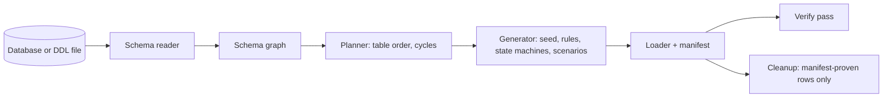

# Data Forge

**Test data that follows your business rules. Generated offline, verified independently, cleaned up safely.**

Point Data Forge at a database schema. It creates rows for every table with every foreign key valid, applies the business rules you write in `forge.yml`, loads the data, checks it with a separate verify pass, and later removes exactly the rows it created.


```
schema  ->  generate  ->  load  ->  verify  ->  clean up before go-live
```

> Release candidate `1.0.0-rc1`. See [What it does not do yet](#what-it-does-not-do-yet) before you rely on it.

---

## Why Data Forge

Four problems it is built for:

- **Rows that point nowhere.** Generated rows need valid parents, composite keys, self-references and cycles.
- **Valid is not correct.** An order total that does not equal the sum of its items passes every type check and still breaks your app. Rules say what must hold.
- **Offline.** Data Forge makes no network calls of its own (a test runs the pipeline with the network cut off). Your schema stays on your machine.
- **Go-live.** Test rows get left behind in production, or someone writes a risky `DELETE`. Cleanup removes only rows a manifest proves Data Forge created.

**Who it is for:** developers, QA and student teams building apps on a relational database. The engine knows no domain; it reads your schema. It is tested on three golden schemas (events and merchandise, e-commerce, multi-tenant SaaS) and on the Pagila DVD-rental sample as a holdout.

---

## Quick start

You need a Postgres database that already has your tables, its password in `PGPASSWORD`, and either Java 21 or the self-contained bundle (see [docs/QUICKSTART.md](docs/QUICKSTART.md)).

```bash
forge init --url postgres://localhost:5432/app --user postgres --password-env PGPASSWORD --env dev
forge generate
forge verify
forge drift
forge cleanup --dry-run
```

`init` reads the schema and drafts `forge.yml` and `forge.schema.json`. `generate` loads rows and records a manifest of what it created. `verify` runs the rules of `forge.yml` in the database. `drift` compares the live schema with the saved snapshot. `cleanup --dry-run` lists what a cleanup would remove and changes nothing.

A freshly drafted `forge.yml` has **no business rules** (it contains `rules: []`), so `generate` prints "No rules in forge.yml: nothing to verify". The data is structurally valid (types, keys, NOT NULL, unique, check, foreign keys). Replace `rules: []` with your rules (see [Business rules](#business-rules)) to make `verify` mean something. The output of these five commands, as run in a clean container against Postgres 16, is in [docs/QUICKSTART.md](docs/QUICKSTART.md) and is checked by `scripts/docs-test.sh`.


---

## How it works



1. **Read.** Tables, keys, uniques, checks, enums, composite keys, self-references and cycles go into one schema graph.
2. **Plan.** Tables are ordered by dependency. A foreign key cycle is broken where it can be (`init` prints which constraint it deferred); a cycle that cannot be broken is refused.
3. **Generate.** Every value is a function of the seed, the table, the column and the row number. Same seed and config, same data.
4. **Load.** Rows are streamed into the database. A manifest of exactly what was created is written in the same database transaction ([design](docs/design/MANIFEST.md)).
5. **Verify.** Each rule is compiled to SQL and run by the database. The generator does not depend on the verify module, so one bug cannot fool both.
6. **Clean up.** Cleanup deletes only rows the manifest proves are still Data Forge's.


---

## Features

### Reads a schema

`forge init` reads a live Postgres database, or a DDL file that it applies to a scratch Postgres. Composite keys, self-references, many-to-many tables, deferrable constraints and foreign key cycles are handled. `init` and `generate` ran with zero config on the Pagila sample (a holdout schema that was not used to shape the engine).


### Reproducible data

Same seed and same config give byte-identical output (`docs/PERF.md` pins SHA-256 hashes of the 1,000,000-row runs). A failing test can be reproduced exactly. A column without a rule keeps its values when other tables are added or removed. Changing a parent's row count changes which parent each child row points to.


### Business rules

Write a rule once. The data follows it by construction, and the verify pass checks it.

```yaml
rules:
  - name: order_total_matches_items
    derive: orders.total_paise = sum(order_items.quantity * order_items.unit_price_paise)
  - name: registration_within_ticket_quantity
    limit: sum(registrations.quantity) per registrations.ticket_type_id <= ticket_types.quantity
  - name: payment_completed_after_created
    check: payments.completed_at >= payments.created_at
```

Rule kinds: `derive` (a calculated column), `check` (a condition every row must meet), `limit` (a capacity), time order (`before` and `after`, with a `by:` gap range), and `verify` (like `check`, but run only by the verify pass; the generator ignores it). A rule that cannot be read is rejected with an error that names the rule. See [docs/RULES_GUIDE.md](docs/RULES_GUIDE.md).


### Realistic shape

State machines (`pending` to `paid` to `refunded`) with the child rows each state needs. Time rules (a registration before the event it is for). Skewed (Zipf and Pareto) distributions, correlated columns, and seasonality. Locale-aware values that pass independent checkers: Indian phone numbers, pincodes and GSTIN, and IBANs.


### Scenarios and edge cases

Scenarios named in `forge.yml` change the row counts and the mix on demand. The events example (`golden/events-merch/phase3.forge.yml`) defines `default` and `sale_rush` (twice the orders and a different status mix). Edge-case mode (`--edge`) adds unusual values; the CLI lists NULLs, maximum lengths, Unicode, case-only duplicates, leap days, daylight-saving times and injection-like strings as its aims. A run on the events example produced a Unicode event name and case-only duplicate emails; the others have not been checked here.

```bash
forge generate -s sale_rush
forge generate --edge
```


### Verify, with honest results

Every rule ends in one of these states. `forge verify` never shows a rule it could not check as passed.

| State | Meaning |
|---|---|
| passed | The database confirmed the rule holds |
| failed | The rule, the table and the row that broke it |
| not checked | Data Forge cannot check this rule (not applicable, or enforced by the database itself). Listed, never counted as passed |

`forge verify --url <database>` also verifies a database Data Forge did not create, such as staging. The session is read-only there.


### Drift check for CI

Compares the live schema with the saved snapshot `forge.schema.json`, and the spec with the live schema. Each change is graded error, warning or info by one test: an error means `forge generate` would fail or lie right now. In a run here, a new nullable column and a new table were both warnings (exit 0), and `--fail-on warning` made the same drift exit 1. Exit code 0 means no drift at the threshold (`--fail-on`, default `error`), 1 means drift at or above it, 2 means the check could not run. `forge.yml` is never rewritten; the only file `drift` writes is the snapshot, and only with `--accept`.


### Output files

Besides loading into a database: SQL, CSV or JSON files, one per table (`NNN_table.ext`, numbered in load order), with a manifest beside them.

```bash
forge generate --out sql --out-dir out
```


### Safe cleanup

Cleanup is the only thing in Data Forge that deletes, so it refuses by default.

```bash
forge cleanup --dry-run     # counts per table. Changes nothing
forge classify              # report rows that are not in the manifest. Never deletes
forge cleanup --run         # needs a fresh dry run, a backup, and a typed confirmation
forge readiness             # pass or fail: is the database clean for go-live? Prints the manual checklist
```


More in [docs/SAFETY.md](docs/SAFETY.md).

---

## Safety model

Cleanup removes a row only if its key is in the manifest and its fingerprint still matches what was recorded at load time. A row someone edited is not deleted.

| Guard | What it does |
|---|---|
| Environment label | Each connection is `dev`, `test`, `staging` or `prod`. Generation into prod is always refused. Cleanup on prod needs `--allow-prod` |
| Dry run first | A run is refused without a dry run of the same manifest from the last 24 hours |
| Typed confirmation | You type the database name and the total row count. It is never filled in for you |
| Backup gate | Your `backup_cmd` runs first. If it fails, nothing is deleted |
| Real data blocker | A real row that points at a manifest row stops the cleanup and is listed |
| Count check | Each batch is one transaction and rolls back if the count is wrong |
| Keep list | Reference tables are never touched |
| Truncate only at 100% | Used only when the manifest covers every row of the table |
| Audit log | Every dry run, run and refusal is logged. If the log cannot be written, cleanup stops |

**Always take a backup and start with a dry run, and never run it against anything you cannot restore.** The tests cover the cases written down in [docs/SAFETY.md](docs/SAFETY.md), not every possible case. Data Forge cannot clean uploaded files, payment gateway test orders, sent emails, logs or caches. `forge readiness` prints that manual checklist.

---

## Ways to use it

All of them call the same engine. The command line and MCP read `forge.yml`; the web UI and the terminal UI write their own from the connection you give them.

### CLI
The commands above. Every command has `--json` output with a versioned envelope (`forge.output/1`), so you can pipe it into `jq` or CI.

### Terminal UI
A numbered menu: connect, schema, run (generate), verify, and go-live (a cleanup dry run, readiness and the manual checklist). It cannot run a cleanup. It makes no network calls.


### Web UI
A local page on `127.0.0.1` with a session token: connect, schema graph, run, verify, and go-live. It cannot run a cleanup; it shows the exact command for you to type.


### MCP server (optional)
`forge mcp` lets an AI agent call six tools over stdio: `forge_verify`, `forge_drift`, `forge_classify`, `forge_readiness`, `forge_cleanup_dry_run` and `forge_purge_dry_run`. Cleanup through MCP is a dry run only; nothing it offers deletes, and it never connects with a prod label. The core product never needs an AI or the network.


Setup and what was tried: [docs/MCP.md](docs/MCP.md). Terminal and web UI details: [docs/UI_AND_TUI.md](docs/UI_AND_TUI.md).

---

## Databases

| Database | Status |
|---|---|
| PostgreSQL 16 | Full target. All golden schemas and the Pagila holdout. Also run on 17 for information |
| MySQL 8.4 | Works on translated golden schemas. Not every Postgres type is covered. `init` does not read MySQL |
| SQLite | Works on translated golden schemas. `init` does not read SQLite |
| Supabase, Neon and other Postgres hosts | Expected to work. Not tested. See [docs/SUPABASE_AND_PRISMA.md](docs/SUPABASE_AND_PRISMA.md) |
| Prisma apps | Point Data Forge at the database Prisma creates. Not tested |

---

## Speed

Measured on an Apple M4 MacBook Air with 16 GB, Java 21, Postgres 16 in Docker, with a 256 MB heap. Source and dates: [docs/PERF.md](docs/PERF.md).

| Shape | Rows | Time |
|---|---|---|
| One table | 1,000,000 | 4.4 s |
| 1M parents and 3M children | 4,000,000 | 19.4 s |
| Events schema with rules and state machines | 4,019,699 | 177.0 s |
| Tied composite keys | 3,010,000 | 31.6 s |

On the same machine, one table of 1,000,000 rows takes 12.6 s on MySQL and 6.0 s on SQLite.

---

## What it does not do yet

Honest limits, in full in [docs/LIMITS.md](docs/LIMITS.md):

- **A drafted `forge.yml` has no business rules.** You write them. Some rules cannot be written yet; `forge verify` lists what it did not check and never counts it as passed.
- **MySQL and SQLite** run translated golden schemas only, and `forge init` reads Postgres or a DDL file. MySQL cleanup handles one kind of self-referencing table and refuses the rest.
- **CSV output** is for inspection and Postgres `COPY`, not for loading into MySQL or SQLite.
- **A time-gap rule** can fail when a parent's time leaves no room for the gap. The error says so.
- **The web UI and terminal UI** start with Gradle from the source tree, not from the packages. With MySQL or SQLite they show the schema only. A prod label is refused at connect.
- **The JUnit 5 extension** exists in the source tree but has only a smoke test. It is not documented as a feature in this release.
- **Not tested:** Windows and Linux, Supabase, Neon, Prisma, an AI client connected to MCP.
- **Outside the database:** payment gateways, files, queues, email and caches are not simulated or cleaned.

---

## Documentation

[Quick start](docs/QUICKSTART.md) | [Commands](docs/COMMANDS.md) | [Config](docs/CONFIG.md) | [Rules guide](docs/RULES_GUIDE.md) | [Safety](docs/SAFETY.md) | [MCP](docs/MCP.md) | [UI and TUI](docs/UI_AND_TUI.md) | [Architecture](docs/ARCHITECTURE.md) | [Limits](docs/LIMITS.md) | [Release](docs/RELEASE.md) | [Changelog](CHANGELOG.md)

## Contributing and security

See [CONTRIBUTING.md](CONTRIBUTING.md) and [SECURITY.md](SECURITY.md). Use Data Forge only on databases you are allowed to change and can restore.

## Licence

MIT. See [LICENSE](LICENSE) and [THIRD_PARTY_NOTICES.md](THIRD_PARTY_NOTICES.md). The Pagila sample schema used as a test target is under its own licence, kept beside it in `golden/holdout/pagila/LICENSE.txt`.
